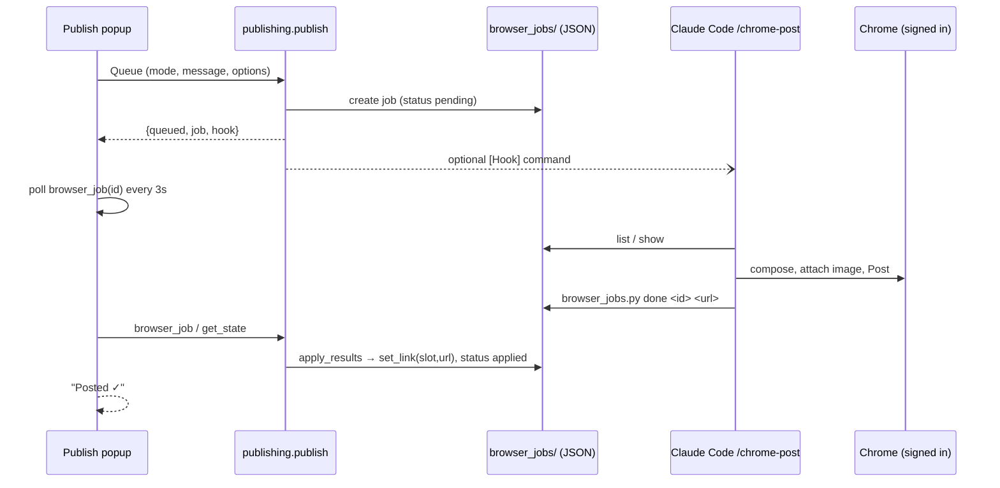

# Browser hook — posting via Claude in Chrome

Most social platforms either have no API for a **personal** account (LinkedIn, Facebook
profiles: the Graph API reaches Pages only), charge for one (X is pay-per-use), or need a
business account plus a developer app (Instagram, Threads, TikTok, Pinterest). So by
default WriterHelper doesn't post to them itself. It **queues a job**, and Claude Code's
`/chrome-post` skill posts it in the operator's real, signed-in Chrome via the Claude in
Chrome extension, then reports the post URL back. That needs no Claude API key, no
developer apps, and no tokens to rotate. Bluesky stays native ([[bluesky-adapter]]):
its API is free and trivial.

Code: `platforms.py` (routes), `browser_jobs.py` (queue + CLI), `publish_config.py`
(operator knobs), `web/js/publish-browser.js` (popup panel),
`.claude/skills/chrome-post/SKILL.md` (the Chrome side).



## Transport per platform

`Platform.transport` is `"api"` or `"browser"`. It's the operator's pin in
`settings_publish.ini [Transport]` when that route exists for the platform, else
`default_transport`. Read live, so no restart is needed.

| platform | default | api alternative |
|---|---|---|
| Bluesky | api | — (no browser route) |
| X | browser | `x = api` → [[x-adapter]] (pay-per-use) |
| Facebook | browser (personal profile) | `facebook = api` → [[facebook-adapter]] (Page) |
| Instagram | browser (local upload) | `instagram = api` → [[instagram-adapter]] (two-step repo push) |
| LinkedIn, Threads, Pinterest, TikTok, Medium | browser | — |

`Platform.via == "browser"` drives the 🌐 badge on the meta panel's publish buttons
([[link-slots]]).

## The job (`browser_jobs/<id>.json`, CWD, git-ignored)

`id` = `<yyyymmdd-hhmmss>-<platform>-<hl>-<4 random>`. Fields: `status`, `platform`,
`label`, `compose_url`, `hl`, `account` (expected handle), `mode`, `posts` (one, or a
thread's numbered segments), `title`, `image` (an **absolute** local path, first post
only), `alt_text`, `link` (article URL; Pinterest's destination), `link_slot`,
`max_length`, `article {hl, slug, translation_key, title}`, `url`, `error`, `board`
(Pinterest only).

Lifecycle: `pending` → `done` (skill reported a URL) → `applied` (the app wrote it into
the slot). Other endings are `failed` (with `error`, shown in the popup) or
`cancelled`. Writes are atomic (tmp + `os.replace`) because the app and the skill
touch the same files.

## Invariants

- **Results are pulled, never pushed.** `apply_results(article)` runs from
  `webapi.get_state`, `prepare_post` and `browser_job` (the popup's 3 s poll). It
  matches jobs by `hl` + sticky `translationKey` (slug as fallback), so a title edit
  between queue and post doesn't orphan the URL ([[bilingual-pairing]]). If the article
  isn't open, the URL lands the next time it is.
- **A slot filled by hand wins.** `apply_results` never overwrites a non-empty slot.
- **Double-post guards:** an existing link ([[link-slots]]) *and* a still-`pending` job
  for the same article + platform both refuse `publish`. The popup reopens on the
  job's status panel instead of the composer. Failed or cancelled jobs release the
  guard ("Edit & re-queue").
- **Same validation as native posts.** Facets, char limits, image-required, thread
  support, and image resolution all go through `publishing._plan` before either route
  ([[social-publishing]]).
- **The skill never retries blindly.** If a post went out but its URL can't be found,
  it asks or `fail`s with "paste it by hand".
- **Job ids are path-checked.** `load()` rejects `/ \ .` so the CLI can't escape
  `browser_jobs/`.

## The hook command (optional)

`settings_publish.ini [Hook] command`, e.g. `claude --chrome "/chrome-post {id}"`, runs
after each queue (`{id}`, `{job}` = absolute job path), detached with `shell=True` (it's
the operator's own config, and the shell resolves `claude.cmd` on Windows) and
`CREATE_NEW_CONSOLE` so an **interactive** Claude session opens where the operator can
watch and approve. Empty means nothing runs, and the popup shows `/chrome-post <id>` with
a Copy button. "Run hook again" re-launches it for a pending job. Running `/chrome-post`
with no id posts every pending job, which works well for a batch after queueing several
platforms.

## Image attachment in Chrome

The skill tries, in order: (a) the extension's `file_upload` on the composer's file
input; (b) `python browser_jobs.py clip <id>`, which puts the image on the OS clipboard
(PowerShell `Clipboard.SetImage` on Windows, `osascript` on macOS, `xclip` on Linux),
then paste; (c) ask the operator to attach the given path.

## `settings_publish.ini` (git-ignored, not secret, all keys optional)

```ini
[Transport]          ; browser | api, only where both exist
x = api
[Hidden]             ; drop these publish buttons (a filled slot stays as a field)
platforms = pinterest, medium
[Hook]
command = claude --chrome "/chrome-post {id}"
[Accounts]           ; expected signed-in handle: <platform>_<hl>, else <platform>
x_en = Martin_Gamsby
x_fr = MartinGamsby
[Pinterest]
board_fr = Blogue
board_en = Blog
```

## See also
- [[social-publishing]] · [[publishing]] · [[link-slots]] · [[web-ui]] · [[secrets]]
